<picture>
  <source media="(prefers-color-scheme: dark)" srcset="assets/banner-dark.svg">
  
</picture>

Mechatronics engineer (UPC, top 10%) working as Instrumentation & SCADA Engineer at
LabProjects: I keep Peruvian water utilities' SCADA systems running and their flowmeters
honest. Outside work I build things that touch the physical world, and lately I've been doing
computational number theory. My math repos ship with the code that regenerates every result.

### Selected work

**Instrumentation & SCADA**

- **[Bulk Meter Verification](https://github.com/AndyRCC/contrastacion-emapica)** · [case study ↗](https://andyrcc.github.io/contrastacion-emapica/)  
  Field verification of 53 bulk water meters at a utility's wells and reservoirs against a
  portable clamp-on ultrasonic reference. 41 tested on site; 15 corrected in the field without
  cutting supply, all re-verified.
- **[Reservoir Outlet 3D](https://github.com/AndyRCC/simulacion-reservorio-3d)** · [live ↗](https://andyrcc.github.io/simulacion-reservorio-3d/)  
  Three.js simulation driven by real 1D hydraulics (Manning; H2, H3 and S2 profiles; vena
  contracta). Shows why an electromagnetic flowmeter on a partly full outlet over-reads by
  about 35%, and how a gooseneck fixes it.

**Software & ML**

- **[HydraDetect-AI](https://github.com/AndyRCC/HydraDetect-AI)** · [live demo ↗](https://andyrcc.github.io/HydraDetect-AI/)  
  Finds clandestine water bypasses from the echo of a controlled water hammer. The same
  17-feature extractor runs bit-exact on the desktop trainer and on an Arduino Q, where a
  soft-voting ensemble works offline; 89% accuracy in a field pilot (n = 36).
- **[Hoardling](https://github.com/AndyRCC/hoardling)**  
  A C# / .NET WPF desktop pet that tracks my Claude Code and Antigravity usage limits through
  local hooks, with no telemetry.

**Mathematics**

- **[Erdős–Straus: blind shifts](https://github.com/AndyRCC/erdos-straus)** · [DOI 10.5281/zenodo.24569380](https://doi.org/10.5281/zenodo.24569380)  
  For every shift $c \equiv 3 \pmod 4$, the primes $n \le N$ at which the shift fails number
  $\asymp N(\log N)^{-3/2}$, extending Dahan's theorem for $c = 7$ and settling $c = 3$ (via
  Fuchs–Hsu–Rickards–Schindler–Stange). Also conditional results on $m(p)$, and its exact
  value for all 128,671,219 "hard" primes below $10^{11}$. Not a proof of the conjecture.
- **[Period–trace correlations: an audit](https://github.com/AndyRCC/bsd-period-trace-audit)** · [DOI 10.5281/zenodo.24450625](https://doi.org/10.5281/zenodo.24450625)  
  Independent audit of recent claims linking Frobenius traces $a_p$ to the invariants in the
  BSD formula, on Cremona's tables ($N < 10^5$). The headline correlation replicates; at rank 0
  the BSD identity routes it through the Tamagawa product, where the bad-prime Euler factor
  acts as a collider, and at ranks 1–2 it reverses sign within strata (a Simpson effect).
- **Upstream fix in [JohnCremona/ecdata](https://github.com/JohnCremona/ecdata)**  
  Found and reported a documentation error in the `allgens` file format; my fix
  ([#8](https://github.com/JohnCremona/ecdata/pull/8)) was merged by John Cremona.

### Toolbox

- **Instrumentation:** electromagnetic and ultrasonic flowmeters, clamp-on verification,
  FUXA SCADA/HMI, Siemens S7-1200
- **Systems:** Linux, Docker, VPS hardening
- **Code:** Python (NumPy, Numba, scikit-learn, FastAPI, PyQt5), C# / .NET (WPF),
  JavaScript (Three.js), C++ (Arduino)
- **Math:** PARI/GP, SymPy, segmented sieves, reproducible pipelines

---

[andyrcc.github.io](https://andyrcc.github.io/) · [LinkedIn](https://www.linkedin.com/in/andy-ricardo-casafranca-carrascal-215982115) · [andycasafranca@hotmail.com](mailto:andycasafranca@hotmail.com)
